# SecureShip

### Automated Application Security & DevSecOps Pipeline

[](https://github.com/saadkvp03/SecureShip/actions/workflows/ci.yml)

**A local-only application security and DevSecOps laboratory** combining a real FastAPI + React shipment application with authentication, Docker hardening, and automated security gates.

## DevSecOps at a Glance

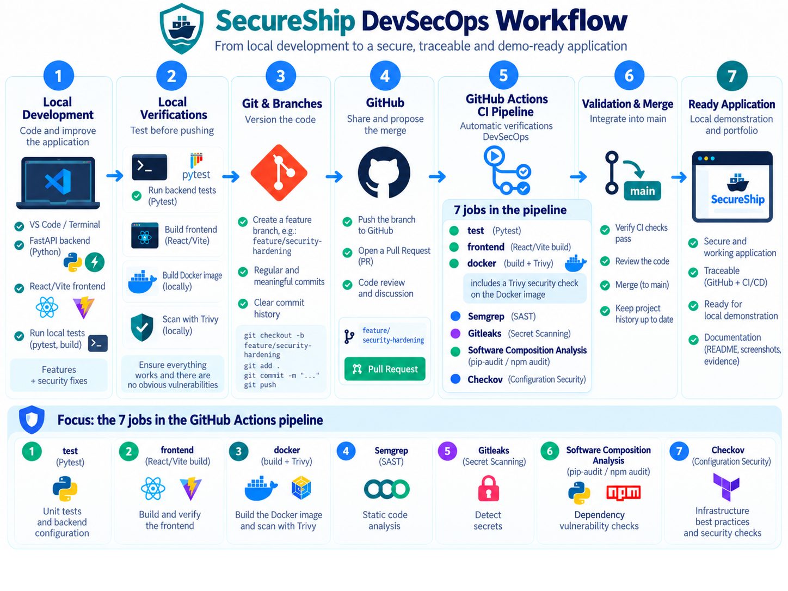

*Overall project lifecycle, from local FastAPI/React development to GitHub, automated quality and security checks, Docker packaging and a validated local application. The seven GitHub Actions jobs are listed below; Actionlint is a local-only check.*

## 1. Project Overview

SecureShip is a hands-on cybersecurity and DevSecOps portfolio project focused on building a small application and progressively securing its software delivery lifecycle.

The project simulates a fictional logistics company that manages shipments. It is made of a REST API (FastAPI + SQLite) and a modern web interface (React + TypeScript), which together serve as a practical target for functional testing, containerization, threat modeling, and automated security checks.

**Project status (October 2026):** The application and its initial security-hardening phase are implemented. GitHub Actions runs seven jobs covering application tests, frontend compilation, Docker smoke tests, Semgrep, Trivy, Gitleaks, dependency audits, and Checkov. Pull Request [#2](https://github.com/saadkvp03/SecureShip/pull/2) was merged after all 14 PR checks passed. DAST with OWASP ZAP remains future work.

> **Scope:** Educational laboratory using fictional data. This is not a production-ready logistics platform.

## 2. Project Objectives

- Build a REST API with Python and FastAPI.
- Provide a real web interface for end users (not only Swagger).
- Persist shipment information in SQLite.
- Write repeatable automated tests with Pytest.
- Package and run the application with Docker.
- Manage source code and history using Git and GitHub.
- Create a CI/CD pipeline using GitHub Actions.
- Integrate automated code, dependency, container, secret, and Infrastructure as Code security checks.
- Investigate findings, apply fixes, and verify their effectiveness.
- Document technical decisions, evidence, and remediation results.

## 3. Implemented Features

### Web interface (`/app`)

- **Dashboard:** shipment totals per status, a status distribution chart, and recent activity. Everything is computed from SQLite; nothing is simulated. A dedicated empty state invites you to create the first shipment.
- **Shipments:** searchable (recipient, destination, origin, tracking reference; case and accent insensitive), filterable by status, sortable, paginated. Quick action to move a shipment to its next status.
- **Create a shipment:** validated form (recipient, destination, optional origin and notes). A readable tracking reference such as `SS-7K4Q9M` is generated.
- **Shipment details:** information, tracker (created → in transit → delivered) and the real history of status changes with timestamps.
- Light and dark themes, responsive layout (desktop, tablet, phone), toast notifications, loading and error states, keyboard-accessible controls.
- The interface is in French. A **single local operator login** now protects the shipment API. It remains a local-only security laboratory, not a production application.

### Application Preview — Local Deployment

The following screenshots show the **actual locally hosted SecureShip interface** at `http://127.0.0.1:8000/app/`, using fictional shipment data. They do not represent a public Internet deployment.

**Operator login (before authentication)**

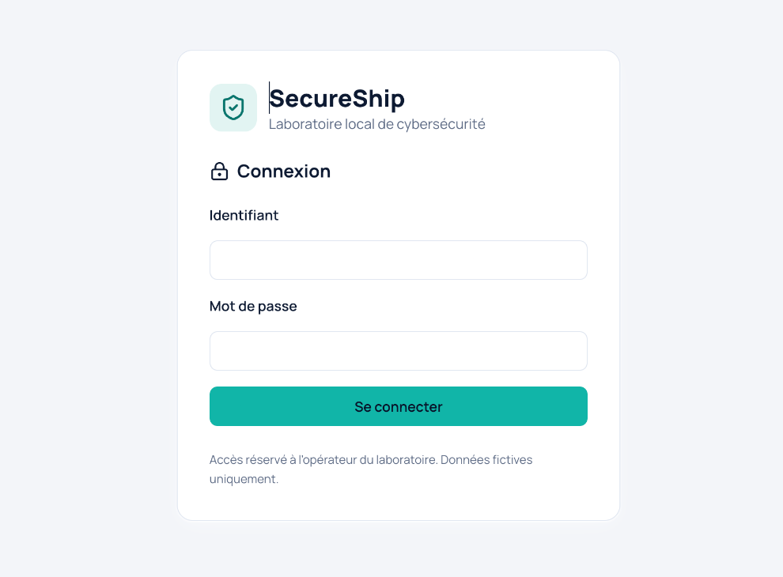

**Authenticated dashboard**

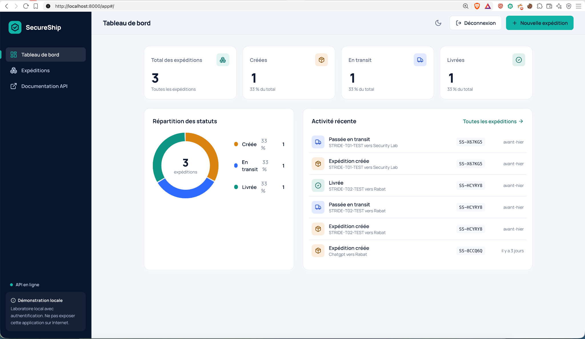

The dashboard retrieves shipment counts and history from SQLite after login; protected API endpoints are not exposed to anonymous users.

### API endpoints

| Method | Endpoint | Purpose |
| --- | --- | --- |
| `GET` | `/` | Application information (JSON, unchanged) |
| `GET` | `/health` | Check application availability (public) |
| `POST` | `/auth/login` | Local operator login; sets HttpOnly session cookie |
| `GET` | `/auth/me` | Check current session and obtain anti-CSRF token |
| `POST` | `/auth/logout` | Revoke current session (requires CSRF token) |
| `POST` | `/shipments` | Create a shipment |
| `GET` | `/shipments` | List shipments (optional search, filter, sort, pagination) |
| `GET` | `/shipments/{shipment_id}` | Shipment details with status history |
| `PATCH` | `/shipments/{shipment_id}/status` | Update a shipment status |
| `GET` | `/stats` | Totals per status and recent activity |
| `GET` | `/docs` | Swagger UI |
| `GET` | `/app` | Web interface (after `npm run build`, or in Docker) |

Statuses: `created`, `in_transit`, `delivered`.

`GET /shipments` still returns a plain JSON list. Query parameters are optional: `q`, `status`, `sort` (`id`, `recipient`, `destination`, `status`), `order` (`asc`, `desc`), `limit` (1–200), `offset`. The number of matching shipments is returned in the `X-Total-Count` header.

**Example request body for `POST /shipments`** (`origin` and `notes` are optional):

```json
{
  "recipient": "Test Client",
  "destination": "Rabat",
  "origin": "Casablanca",
  "notes": "Fragile"
}
```

**Example request body for `PATCH /shipments/1/status`:**

```json
{
  "status": "in_transit"
}
```

### Authentication (local security lab)

- One operator configured **on the local machine only**; no registration, user database, or public hosting.
- Password stored only as a salted **scrypt hash** in `.env` (the plain password is never stored).
- Cryptographically random, opaque session cookie with `HttpOnly` and `SameSite=Strict`;
  its SHA-256 digest and expiration are stored in the existing SQLite database.
- HTTP APIs `/shipments`, `/shipments/{id}`, `/shipments/{id}/status` and `/stats` require a valid session.
  HTTP POST/PATCH/`/auth/logout` also require a valid `X-CSRF-Token` header.
- Public: `/`, `/health`, `/docs`, static `/app` login shell (data APIs remain protected).
- The cookie uses `Secure=False` solely because this lab is hosted on `127.0.0.1` over HTTP.
  Never reuse this configuration on the public Internet: a hosted application would need HTTPS,
  `Secure` cookies, brute-force throttling, a full IAM/privacy review, and additional hardening.
- **Important:** this changes the original unauthenticated API contract; old anonymous
  curl requests now deliberately return HTTP 401.

### Database

SQLite with shipment tables `shipments` and `shipment_events` (the status history), plus a small `auth_sessions` table for login sessions. Older databases are upgraded automatically and non-destructively at startup: new columns are added, existing rows are kept and receive a tracking reference. For shipments created before this upgrade, the creation date and history were never recorded, so they stay empty instead of being invented. All SQL values are bound parameters.

## 4. Technology Stack

**Implemented:**

- **Backend:** Python 3.11, FastAPI, Pydantic, SQLite.
- **Frontend:** React 18, TypeScript, Vite 5, Tailwind CSS, Lucide icons; the dashboard chart uses plain SVG.
- **Testing:** Pytest, FastAPI TestClient, TypeScript type checks, Vite production build, Docker authentication and shipment smoke tests.
- **Packaging:** multi-stage Docker build, Docker Compose, non-root runtime (UID 10001), persistent SQLite volume.
- **CI:** GitHub Actions with seven jobs and blocking security gates.
- **SAST:** Semgrep OSS (`--error`) with documented triage of reviewed findings.
- **Container vulnerability analysis:** Trivy full JSON report and a gate for fixable HIGH/CRITICAL issues.
- **SCA:** `pip-audit` for Python dependencies; `npm audit --omit=dev` for frontend production dependencies.
- **Secret scanning:** Gitleaks against Git history.
- **Configuration scanning:** Checkov for Dockerfile and GitHub Actions workflows.
- **Local CI linting:** Actionlint with ShellCheck (not yet automated in CI).

**Next / not implemented:** OWASP ZAP DAST, optional additional IaC/Terraform lab exercises, and completion of the final security report. **No cloud infrastructure is deployed.**

## 5. Project Structure

```text
SecureShip/
├── .github/
│   └── workflows/ci.yml    # 7 jobs: tests, build, Docker/Trivy, SAST, secrets, SCA, IaC
├── app/
│   ├── auth.py             # Scrypt, revocable server sessions, CSRF
│   ├── main.py             # FastAPI routes, models, serves the interface at /app
│   └── database.py         # SQLite schema, migration and queries
├── frontend/               # React + TypeScript + Vite + Tailwind interface
│   ├── src/
│   │   ├── pages/          # Dashboard, Shipments, Detail
│   │   ├── components/     # Layout, dialog, tracker rail, chart, toasts…
│   │   └── lib/            # API client, router, hooks, formatting
│   └── package.json
├── docs/                   # Threat model, triage and security documentation
│   └── assets/             # Curated README diagrams and non-sensitive screenshots
├── infra/
│   └── terraform/          # Infrastructure as Code (planned)
├── scripts/
│   ├── setup_auth.py       # Interactive secret-free-in-Git setup
│   └── seed_demo.py        # Optional fictional demo data (separate database)
├── tests/
│   ├── test_auth.py        # Authentication security regressions
│   ├── test_main.py        # Original 9 API tests
│   ├── test_features.py    # Tests for the new features
│   ├── test_sqli_regression.py # SQL injection regression tests
│   └── conftest.py
├── Dockerfile              # Multi-stage, minimum runtime deps, non-root user
├── docker-compose.yml
├── Makefile                # Shortcuts for the commands below
├── requirements-runtime.txt # Production-only requirements constrained by requirements.txt
└── requirements.txt        # Pinned dependency inventory for local development/tests
```

`.env`, `.venv/`, `node_modules/`, `frontend/dist/`, `.pytest_cache/` and local `*.db` files are excluded from Git. Keep raw scanner JSON outputs and unreviewed screenshots outside the repository. Only the curated, non-sensitive screenshots in `docs/assets/` are intended for publication.

## 6. Run Locally

**Requirements:** Python 3.11, `pip`, and Node.js 20 or newer (only for the interface).

One-time setup, from the project directory:

```bash
python3 -m venv .venv
source .venv/bin/activate
python -m pip install -r requirements.txt
python scripts/setup_auth.py   # interactive; choose YOUR OWN login + strong password
cd frontend && npm install && cd ..
```

### Development (two terminals)

Terminal 1 — API with auto-reload on http://127.0.0.1:8000:

```bash
source .venv/bin/activate
python -m uvicorn app.main:app --reload --env-file .env
```

Terminal 2 — interface with hot reload:

```bash
cd frontend
npm run dev
```

Open **http://localhost:5173/app/**. Vite forwards `/shipments`, `/stats` and `/health` to FastAPI on port 8000 (set `VITE_API_TARGET` to change the target), so no CORS configuration is needed.

### Single port, production-like

```bash
cd frontend && npm install && npm run build && cd ..
python -m uvicorn app.main:app --env-file .env
```

Open:

- Web interface: http://127.0.0.1:8000/app
- API documentation (Swagger UI): http://127.0.0.1:8000/docs
- Health check: http://127.0.0.1:8000/health

If the interface has not been built, `/app` shows an explanatory page (HTTP 503) and the API keeps working.

The SQLite database is created automatically at `secureship.db` by default. Credentials live in the ignored `.env` file created by `scripts/setup_auth.py`; never commit or share that file. Its location can be changed using the `SECURESHIP_DB_PATH` environment variable.

### Optional demo data

To try the interface with ten fictional shipments **without touching your real database**:

```bash
python scripts/seed_demo.py                       # writes ./demo.db
SECURESHIP_DB_PATH=demo.db python -m uvicorn app.main:app --reload --env-file .env
```

The script refuses to write to `secureship.db` or to any database that already contains shipments.

## 7. Run Automated Tests

With the virtual environment activated:

```bash
python -m pytest -q
```

The suite includes authentication regressions in `tests/test_auth.py` as well as the original 9 tests (`tests/test_main.py`) plus tests for details, history, tracking references, search, filters, sorting, pagination, statistics, the upgrade of a legacy database, and the `/app` route. Each test uses its own temporary database.

**Local test evidence — 53 tests passed (October 2026 baseline):**

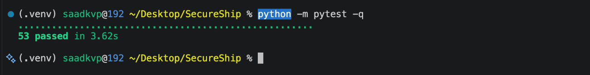

Frontend checks:

```bash
cd frontend
npm run typecheck   # TypeScript only
npm run build       # TypeScript + production build into frontend/dist
```

## 8. Run with Docker

**Requirement:** Docker installed and running (Apple Silicon is supported; the images are multi-architecture).

First configure the account in the repository root (**once**):

```bash
python scripts/setup_auth.py
```

The generated `.env` is ignored by Git. Compose loads it automatically.
**Do not remove the existing named volume, or your shipments will be lost.**

Everything on one port with a persistent volume:

```bash
docker compose up --build
```

Open http://127.0.0.1:8000/app (API docs at `/docs`). Stop with `Ctrl+C`; data stays in the `secureship-data` volume.

**Docker Desktop — locally running SecureShip Compose project:**

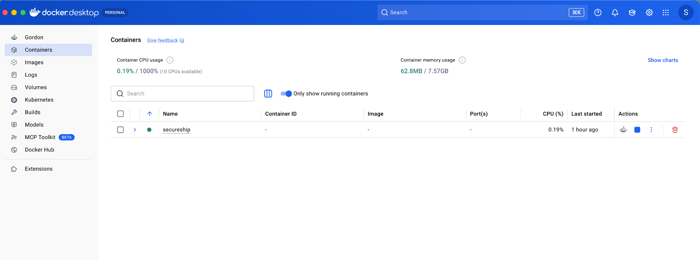

*The green dot indicates a running Compose project in this historical screenshot. The project is collapsed here; it does not show an individual container's details or prove public deployment.*

Without Compose:

```bash
docker build -t secureship:dev .

docker run -d --rm \
  --name secureship-dev \
  -p 127.0.0.1:8000:8000 \
  --env-file .env \
  -v secureship-data:/app/data \
  secureship:dev

curl http://127.0.0.1:8000/health      # {"status":"ok"}
docker stop secureship-dev
```

The Dockerfile builds the interface in a Node stage, then copies only the compiled files into the Python image. The Python stage installs `requirements-runtime.txt` (constrained by the pinned `requirements.txt`), removes unnecessary packaging tools after installation, and applies the available Debian security update for `liblzma5`. The container runs as a non-root user (UID 10001) and has a health check. The `secureship-data` volume stores SQLite data separately from the container.

## 9. DevSecOps CI Workflow

GitHub Actions uses [`.github/workflows/ci.yml`](.github/workflows/ci.yml). The workflow runs on pushes to `main` and `feature/**`, and on pull requests targeting `main`. It validates changes; **it does not deploy the application**.

### What Happens When a Developer Changes Code?

A typical change moves through this review loop: **edit → local checks → Git commit and push → GitHub pull request → automated CI gates → fix/re-run if necessary → merge into `main`**. The pipeline validates changes; it does **not** deploy an application automatically.

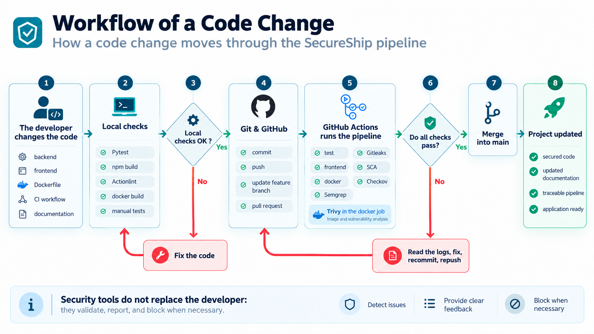

The diagram is an illustrative developer workflow; local checks depend on what was actually executed. The GitHub Actions job graph itself has the dependencies described below.

### Actual GitHub Actions Job Graph

The `docker` job starts only after both `test` and `frontend` succeed. Semgrep, Gitleaks, SCA and Checkov are separate parallel checks.

<details>
<summary>View the successful seven-job dependency graph from GitHub Actions</summary>

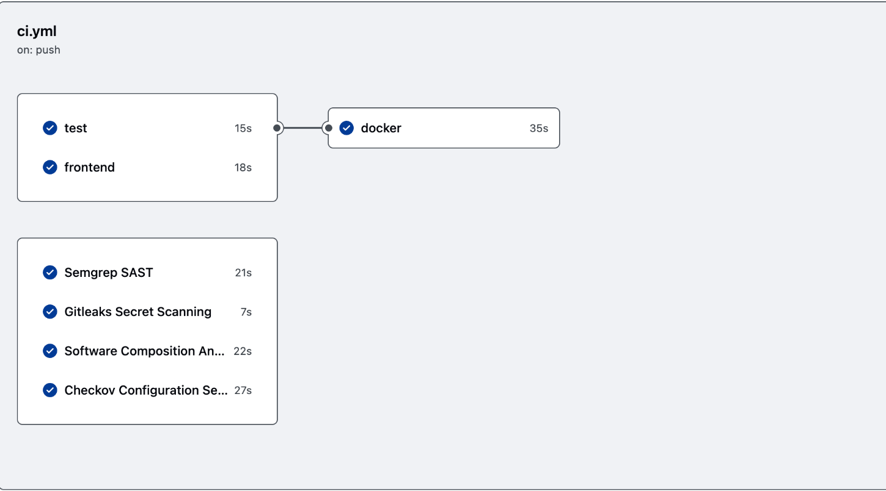

*For current results, consult the [live GitHub Actions page](https://github.com/saadkvp03/SecureShip/actions).*

</details>

| Job | Purpose | Gate / outputs |
| --- | --- | --- |
| `test` | Install Python dependencies and run Pytest. | Fails on test failures. |
| `frontend` | TypeScript checks and Vite production build. | Fails on build errors. |
| `docker` | Build `secureship:ci`; smoke-test health, login, access control, CSRF-protected shipment creation and stats; run Trivy. | **Depends on `test` and `frontend`.** Uploads `trivy-report.json` (14-day retention). Blocks fixable HIGH/CRITICAL Trivy vulnerabilities. |
| `semgrep` | `semgrep scan --config auto --error app/ frontend/src/`. | Fails on remaining reported findings, subject to reviewed in-code suppressions. |
| `gitleaks` | Scan Git history using Gitleaks Action v3 with full-history checkout. | Fails on detected leaks; automatic comments and artifact upload disabled. |
| `sca` | `pip-audit -r requirements.txt` plus `npm --prefix frontend audit --omit=dev`. | Fails on reported dependency vulnerabilities in the scopes scanned. |
| `checkov` | Scan `Dockerfile` and `.github/workflows` using Checkov 3.3.20. | Fails on Checkov policy violations. |

The `semgrep`, `gitleaks`, `sca` and `checkov` jobs are independent of the Docker job and can run concurrently. **The Trivy report is not a clean bill of health**: the gate intentionally excludes issues for which Trivy reports no available fix. Review the complete JSON artifact for residual vulnerabilities.

**Local-only workflow lint:** `actionlint .github/workflows/ci.yml` checks GitHub Actions expressions and shell scripts via ShellCheck. It caught an unused loop-variable warning (`SC2034`), which was corrected before merging PR #2. Actionlint is **not** a separate GitHub Actions job in the current configuration.

### Validated baseline (18 October 2026)

| Validation | Observed result |
| --- | --- |
| Local Pytest suite | **53 / 53 passed** |
| React / TypeScript / Vite | Production build passed |
| Docker | Image build and security smoke tests passed in CI |
| Trivy fixable HIGH/CRITICAL gate | Passed on `secureship:ci` |
| Gitleaks | No leaks detected in SecureShip Git history |
| Checkov (Dockerfile) | 9 passed, 0 failed (local scan) |
| Checkov (GitHub Actions) | 159 passed, 0 failed (local scan) |
| Actionlint + ShellCheck | No reported errors after correction (local run) |
| Pull Request [#2](https://github.com/saadkvp03/SecureShip/pull/2) | **14 successful PR checks; merged** |

Live CI results: [SecureShip GitHub Actions](https://github.com/saadkvp03/SecureShip/actions). This table records one validated baseline; results can change when dependencies, images, tooling or rules are updated.

## 10. Security Findings & Risk Treatment

- **Semgrep:** reviewed three SQL-construction findings. The relevant SQL identifiers/fragments come from trusted code, and dynamic values are passed as bound parameters. Narrow suppressions were accompanied by a SQL injection regression test; see [`docs/07-semgrep-triage.md`](docs/07-semgrep-triage.md). This does not establish that every SQL statement is safe.
- **Trivy:** reduced the image inventory from 175 initial findings to 164 after removing unnecessary runtime packaging tools and patching `liblzma5` (October 2026 local baseline). The remaining findings included HIGH-severity Debian advisories with no identified fix at scan time; there were no reported CRITICAL findings. The **blocking gate** returned no eligible fixable HIGH/CRITICAL findings. This is risk tracking, **not a claim of zero vulnerabilities**.
- **SCA:** `pip-audit` found no known vulnerabilities in the Python requirements during local validation; `npm audit --omit=dev` found none in the production frontend dependency scope. The broader npm audit still reported issues affecting development/build tooling, retained for future triage.
- **Gitleaks:** the SecureShip repository history scan found no leaks. A separate disposable local Git repository was used to verify that a synthetic token remains detectable in history after removal from the latest file version. No real token was used or committed to SecureShip.
- **Checkov:** the Dockerfile and CI workflow checks passed in the recorded scans. These static policies cover specific classes of misconfiguration and do not guarantee production readiness.

For this **localhost-only educational environment**, residual risks are documented and reviewed rather than masked with blanket suppressions or potentially destabilizing dependency upgrades. Reassess all findings before any change of scope or exposure.

### Selected Security Testing Evidence

These screenshots document **historical, authorized local tests**, not a claim that every vulnerability has been eliminated. Sensitive configuration, real tokens and local databases are deliberately excluded. The dedicated security reports provide the detailed interpretation.

<details>
<summary><strong>Semgrep SAST — initial findings, reviewed suppression and a blocking demonstration</strong></summary>

**Initial scan:** three SQL-construction findings in trusted application code were triaged and investigated (452 OSS rules on 25 files).

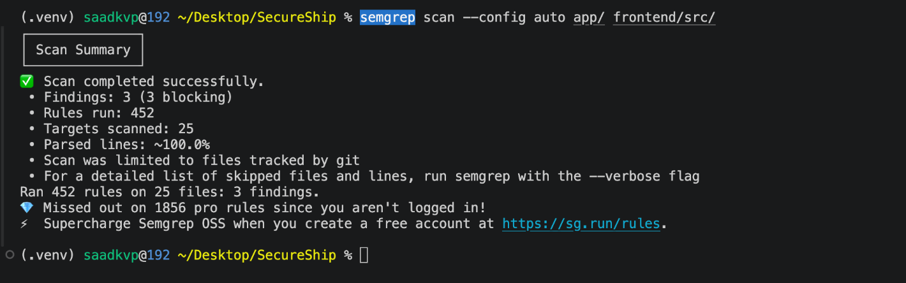

**After review:** precisely scoped `nosemgrep` suppressions, supported by parameterized-query analysis and an SQL injection regression test; zero reported findings in the scanned scope. A clean scan does not prove the absence of every possible flaw.

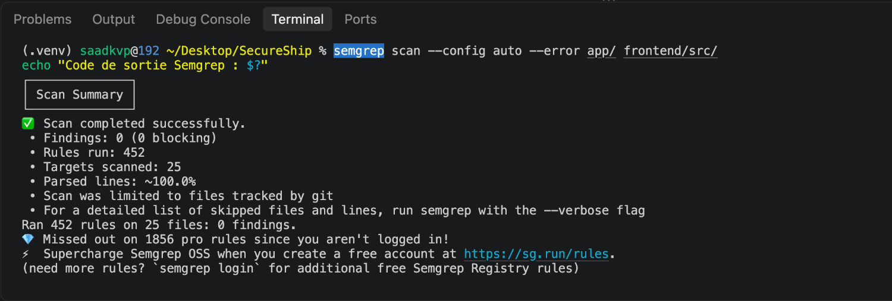

**Blocking behavior demonstrated locally:** a separate disposable test file containing deliberately vulnerable code yielded two blocking findings and an exit code of `1`. This was **not** run against the actual application source or committed to the repository.

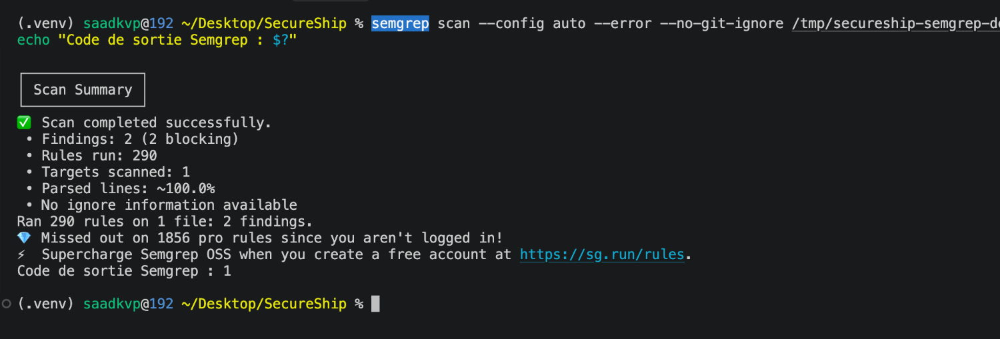

See [`docs/07-semgrep-triage.md`](docs/07-semgrep-triage.md).

</details>

<details>
<summary><strong>SQL injection regression — bound query parameters</strong></summary>

A disposable SQLite database held one fictional shipment. The payload `' OR 1=1 --` was passed to the search and status filters; both returned zero matches instead of bypassing them. The corresponding automated test is `tests/test_sqli_regression.py`.

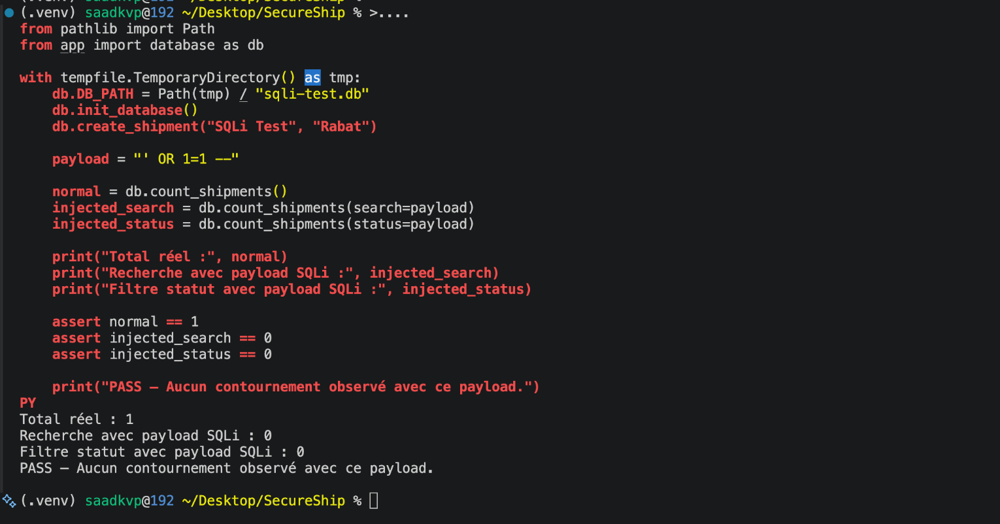

*This single payload and these tested paths do not constitute a complete SQL injection audit.*

</details>

<details>
<summary><strong>Gitleaks — why deleting a secret from the latest file is insufficient</strong></summary>

A **separate throwaway Git repository** with a **synthetic token** was created for a safe demonstration. A directory-only scan reported no current leak:

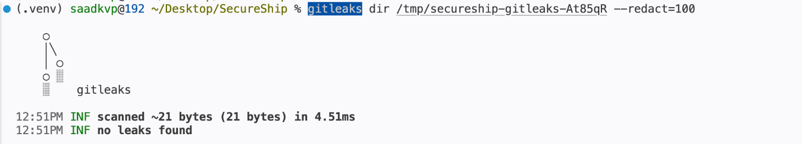

Scanning Git history detected one historical finding:


Deleting the token in a later commit did **not** erase it from Git history; the historical finding remained:

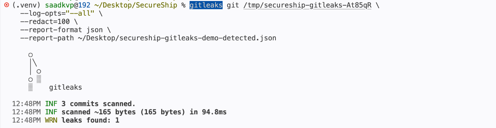

*This is a demonstration repository, **not** a leak from SecureShip. The real SecureShip repository passed its own Gitleaks CI scan.*

</details>

Trivy's complete JSON artifact and the dependency/configuration audit results are documented in [`docs/03-security-findings.md`](docs/03-security-findings.md) and [`docs/04-remediation-validation.md`](docs/04-remediation-validation.md). We do not include raw scanner reports or secrets in this README package.

## 11. DevSecOps & Security Roadmap

- [x] Define the scope and architecture; implement FastAPI, SQLite and the React interface.
- [x] Add authenticated operator sessions, CSRF protection and server-enforced shipment state transitions.
- [x] Build automated API/security regressions; 53 tests passed on the validated baseline.
- [x] Build the multi-stage Docker image and verify non-root runtime and persistent volume behavior.
- [x] Publish the repository and integrate automated checks in GitHub Actions.
- [x] Triage Semgrep findings and enable the blocking SAST gate.
- [x] Implement Trivy reporting and a blocking gate for **fixable** HIGH/CRITICAL issues.
- [x] Integrate Gitleaks, Python/npm SCA and Checkov into CI.
- [x] Validate the GitHub Actions workflow locally with Actionlint + ShellCheck.
- [x] Merge security-hardening Pull Request [#2](https://github.com/saadkvp03/SecureShip/pull/2) after successful checks.
- [x] Document the security findings and remediation-validation baseline.
- [x] Curate selected, non-sensitive README screenshots showing the application and controlled validation tests.
- [ ] Complete the final security report and review all evidence before publication.
- [ ] Perform a separately scoped OWASP ZAP DAST assessment against the authorized local application.
- [ ] Consider adding Actionlint to CI and improving dependency/tool version pinning and reporting.

## 12. Documentation

The `docs/` directory includes the following project documentation (some reports are still in progress):

- [`01-scope-architecture.md`](docs/01-scope-architecture.md) — project scope and architecture.
- [`02-threat-model.md`](docs/02-threat-model.md) — threats and security controls.
- [`03-security-findings.md`](docs/03-security-findings.md) — documented SAST, container, SCA, secrets and configuration findings, including residual risks.
- [`04-remediation-validation.md`](docs/04-remediation-validation.md) — implemented fixes, test evidence, CI results and remaining remediation work.
- [`05-final-report.md`](docs/05-final-report.md) — final report / in-progress reporting.
- [`06-authentication.md`](docs/06-authentication.md) — session, login, CSRF design and local evidence plan.
- [`07-semgrep-triage.md`](docs/07-semgrep-triage.md) — initial Semgrep findings, reviewed suppressions, SQLi regression and enabled blocking gate.

The `docs/assets/` directory contains the two workflow diagrams and selected non-sensitive screenshots used in this README. Raw scanner JSON reports and unreviewed local evidence are kept outside Git by default.

## 13. Limitations & Security Notes

- **Local-only scope:** no public deployment and no real shipment/customer data; Docker Compose binds `127.0.0.1` intentionally. Passing CI does **not** make this production-ready.
- **Authentication:** the application has a single operator and is not a full IAM solution. Local HTTP requires `Secure=False` cookies; a public deployment would require HTTPS, `Secure` cookies, rate limiting, privacy/IAM review, and other controls.
- **Shipment rules:** `created → in_transit → delivered` transitions are server-enforced. Invalid transitions return HTTP 409 and history is retained.
- **SQLite:** adequate for this lab, but not a general scalability or multi-user security architecture. Accent/case-insensitive search is designed for a small demo database.
- **Residual vulnerabilities:** Trivy's `--ignore-unfixed` gate excludes issues without available fixes, while the full report still lists them. npm development dependencies also have findings not included in the production-only SCA gate.
- **Static/automated test coverage:** Semgrep, Gitleaks, Checkov and dependency scanners detect selected classes of issues; they do not replace code review, penetration testing, threat modeling or ongoing patch management.
- **Secrets and state:** `.env`, cookies, session data, `*.db`, dependency directories and Docker volumes are private local state. Never commit credentials or screenshots that reveal them. **Do not run `docker compose down -v` on a volume containing valuable data.**

## 14. Project Status

**Current phase:** Initial application-security and DevSecOps CI hardening **completed and merged** into `main` via [PR #2](https://github.com/saadkvp03/SecureShip/pull/2).

**Next technical phase:** plan authorized **OWASP ZAP DAST** against the local application as a separate piece of work, followed by findings triage and evidence. Complete the remaining security documentation as results become available.

---

*SecureShip is a hands-on, local-only cybersecurity engineering and DevSecOps portfolio project. It is not a production logistics platform.*

## 15. Authentication Security Verification (Local Lab)

From the SecureShip project directory, after `docker compose up -d --build`:

1. Open <http://127.0.0.1:8000/app> and verify the login form is shown.
2. Log in with the **locally chosen** username/password from `scripts/setup_auth.py`.
3. Verify access to existing shipments and create a fictional test shipment.
4. Click **Déconnexion** and confirm protected data cannot be retrieved without a session.
5. Run `curl -i http://127.0.0.1:8000/shipments`: **HTTP 401** is expected without authentication.
6. Run `python -m pytest -q`: the validated October 2026 snapshot passed **53 tests**.

Keep unreviewed portfolio screenshots on your local machine unless you intentionally publish sanitized, non-sensitive copies. Never capture or publish your actual password, `.env`, cookies, CSRF tokens or other credentials. See [`docs/06-authentication.md`](docs/06-authentication.md) for the security design.
